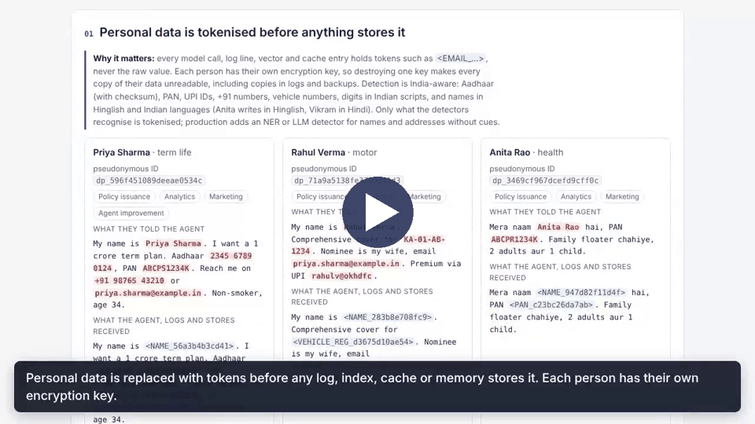
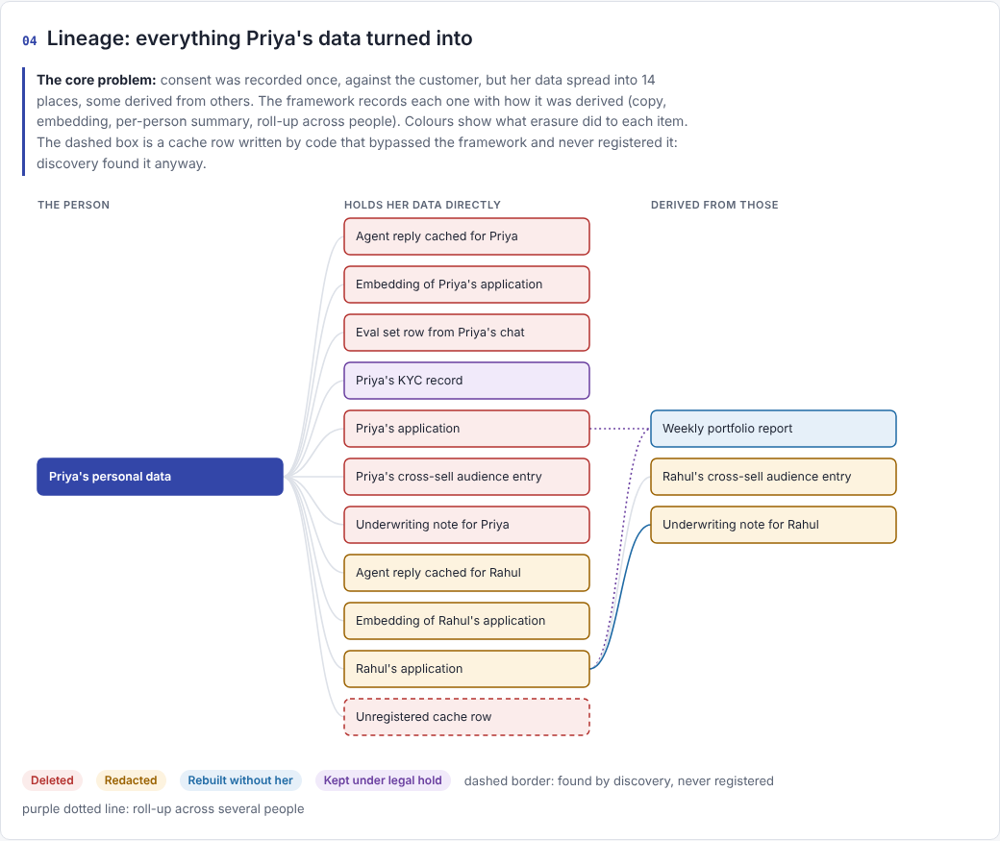

# DPDP Data Rights Framework for AI Agents

**A framework for honouring Data Principal rights (consent withdrawal and erasure first, plus access, correction, nomination and grievances) in GenAI and agentic applications, built for India's Digital Personal Data Protection (DPDP) Act 2023 and DPDP Rules 2025.**

Works with **OpenAI**, **Anthropic Claude** (API direct, or on Bedrock / Vertex), **Amazon Bedrock / AgentCore** and **Google Vertex AI**, and with any domain: insurance, lending, healthcare, telecom, retail, HR or the public sector.

**Scope.** The framework covers consent withdrawal and erasure (Act s.6, s.8(7), s.12(3)) end to end, with
verification and evidence. A [rights workflow](docs/rights.md) handles access (s.11), correction (s.12(1)-(2)),
nomination (s.14) and grievances (s.13, Rule 14(3)) under versioned legal rules. It does not implement
children's data (s.9), Consent Manager integration or breach response (s.8(6)). See
[what is and isn't covered](docs/dpdp-mapping.md#scope).

> Not legal advice. See [docs/dpdp-mapping.md](docs/dpdp-mapping.md) and validate each deployment with privacy counsel.

## Start here

| You are | Start with | Then |
|---|---|---|
| **Seeing it for the first time** | The [2-minute video tour](docs/media/demo-tour.mp4), then [see it in action](#see-it-in-action-offline-no-cloud-account): one command, a visual report, no cloud account | [Demo walkthrough](docs/demo-walkthrough.md) |
| **A partner running a client engagement** | [Partner delivery pack](partner-pack/README.md), "Your first hour" | [Domain packs](docs/domain-packs.md) for insurance, lending, healthcare; [implementation plan](partner-pack/implementation-plan.md) |
| **An engineer adding it to an agent** | [Integration guide](docs/integration-guide.md) | [Configuration](docs/configuration.md), [connectors](docs/connectors.md), [plug-ins](docs/plugins.md) |
| **Deploying it** | [Deploy on AWS](docs/deploy-aws.md) or [Google Cloud](docs/deploy-gcp.md) | [Testing in your account](docs/testing.md), [security](docs/security.md), [operations](docs/operations.md) |
| **A DPO, counsel or auditor** | [DPDP mapping](docs/dpdp-mapping.md) and [limitations](docs/limitations.md) | [Rights workflow](docs/rights.md), [evidence and audit pack](docs/evidence.md), [audit evidence checklist](partner-pack/audit-evidence-checklist.md) |

## Why this exists

The DPDP Act gives every individual (the *Data Principal*) the right to withdraw consent at any time and to have their personal data erased. The organisation (the *Data Fiduciary*) must then stop processing, erase the data, and make its processors do the same, unless another law requires it to keep the data.

Traditional systems handle this by deleting a row in a system of record. AI agents make that insufficient. Take an applicant who gives an insurance onboarding agent their name, Aadhaar, PAN, health disclosures and a nominee's contact details. Within minutes that data has been:

- sent to a model and written to prompt logs, traces and observability spans
- chunked and embedded into a vector index for retrieval
- remembered by the agent (session memory and long-term extracted facts)
- cached as agent responses
- summarised into an underwriting note, and rolled up into a weekly portfolio report
- copied into an evaluation set used to improve the agent
- placed into a marketing audience for cross-sell
- kept in a KYC record that sector regulation says must be retained

Consent, meanwhile, was recorded once against the *customer*. Consent applies per purpose, but the data spreads per *data element* (email, phone, Aadhaar, free text) and across derived artifacts. When the applicant later withdraws consent, nobody can say where their data went, which copies must go, which may stay, or prove that it was done.

## What the framework does

| Capability | What it gives you |
|---|---|
| **Purpose-based consent ledger** | Consent recorded per Data Principal × data element × purpose, with notice version and Consent Manager reference. Processing for a purpose without valid consent is blocked. |
| **Tokenisation at the edge** | Personal data is detected and replaced with tokens *before* it reaches a model, log, index, cache or memory. India-aware: Aadhaar, PAN, UPI, mobile, vehicle, GSTIN, ABHA and more, digits in Indian scripts, and names in Hinglish and nine Indian languages. Combine with Comprehend, Bedrock Guardrails, Cloud DLP, Presidio, AI4Bharat IndicNER or an opt-in LLM detector; read PDFs and scans via Textract or Document AI. Format-preserving surrogates and masked display where a field must keep its shape ([PII detection](docs/pii-detection.md)). Each person has their own encryption key, protected by AWS KMS or Google Cloud KMS. |
| **Data lineage graph** | Every artifact the agent creates is linked to the data elements it contains and the artifacts it was derived from, with typed edges: `copy`, `embed`, `transform`, `aggregate`, `train`. |
| **Erasure orchestration** | On withdrawal or erasure request: discover copies (including ones nobody registered), decide per artifact (delete, redact, regenerate, crypto-shred, retain under legal hold, flag model for retraining), execute through native connectors. |
| **Verification and evidence** | Every store is re-checked for tokens and raw values. A hash-chained erasure certificate records every action, exception and legal basis for the DPO or the Data Protection Board. |
| **Rights workflow** | One intake and case model for access, correction, erasure, withdrawal, nomination and grievance requests. Due dates from a versioned, counsel-reviewable rule set; reviewer decisions; signed case histories. Access reports built from the lineage graph; corrections applied once in the vault and seen by every copy; the Rule 14(1) notice generated from the same rules ([rights](docs/rights.md)). |
| **Domain packs** | Insurance, lending and healthcare: purposes with sector legal holds (PMLA, IRDAI, RBI, IMC) for counsel to confirm, policy rules, identifier patterns, rights settings, a prefilled inventory, discovery questions, and offline scenario tests a partner runs against the client's own config ([domain packs](docs/domain-packs.md)). |
| **Evidence and audit pack** | A case record per request with manual actions and independent reviewer sign-off (checklist, separation of duties, no personal data in notes), all hash-chained and signed. Signed evidence bundles that auditors verify offline, and audit packs for any period: SLA, sign-off, the whole certificate chain checked, findings ([evidence](docs/evidence.md)). |
| **Retention-aware** | Legal holds (e.g. KYC record keeping) keep data in place under a sealed key. For the DPDP Rules' one-year retention, the person's identifiers are kept in a sealed escrow, readable only through audited break-glass access and purged when the period ends. Full records, log retention and traffic data need deployer settings; see [Rule 8(3)](docs/dpdp-mapping.md#rule-83-one-year-retention). |
| **Production security** | Authenticated, role-based Rights API (API keys, OIDC); durable job queue with resume; KMS-signed certificates in immutable storage; audited break-glass; tenant isolation; production guardrails. See [docs/security.md](docs/security.md). |
| **Pluggable, with a conformance kit** | Connectors, detectors, key wrappers, vault storage, model providers, queues and notifiers are plug-ins: partners add a client's systems as their own packages, without forking. Every connector declares what it can find, do and verify ([capability matrix](docs/capabilities.md)) and must pass the same conformance suite ([plug-ins](docs/plugins.md)). |
| **Observability without leaks** | OpenTelemetry spans tagged with the pseudonymous principal and tokenised before export; erasure metrics and SLA alerts; collector configs for X-Ray/CloudWatch and Cloud Trace. See [docs/observability.md](docs/observability.md). |

Erasure becomes tractable because stores receive tokens instead of the identifiers the detectors find. For that data, destroying one person's key makes every copy unreadable, including copies in immutable logs and backups. Lineage tells you which derived artifacts (summaries, audiences, eval rows, fine-tuned models) also need action. Coverage depends on routing data through `protect()` and on the detectors you configure: regex alone misses names, addresses and free-text disclosures, and Indian-language detection is still weak. Connector discovery and verification are the safety net for what tokenisation misses; see [limitations](docs/limitations.md).

## How it maps to DPDP

| DPDP obligation | Framework feature |
|---|---|
| Consent must be specific to a purpose; withdrawal as easy as giving it (Act s.6) | Consent ledger per element and purpose; `withdraw_consent()` |
| On withdrawal, stop processing and make processors stop (s.6(6)) | `protect()` refuses further processing; connectors reach processor-held data (model providers, clouds, SaaS) |
| Erase when consent is withdrawn or the purpose is served, unless law requires retention (s.8(7)) | Purpose-scoped and full erasure; legal-hold purposes |
| Right to erasure on request (s.12(3)) | Rights API / CLI → orchestrator → certificate |
| Reasonable security safeguards (s.8(5), Rule 6) | Tokenisation, per-person keys protected by AWS KMS / Cloud KMS, tokenised logs |
| Minimum one-year retention of personal data, traffic data and logs (Rule 8(3)) | **Partial**: identifiers kept in a sealed escrow with scheduled purge; tokenised logs readable through break-glass if you keep them a year; full records and traffic data are not archived ([details](docs/dpdp-mapping.md#rule-83-one-year-retention)) |
| Accountability and audit (s.8(1), s.10 for Significant Data Fiduciaries) | Case records with reviewer sign-off, signed evidence bundles, period audit packs; templates for control mapping, processor responsibilities and audit evidence |
| Access to a summary of data, processing and recipients (s.11) | Access report from the vault, lineage, consents and the recipient list; reviewed, then released |
| Correction, completion and updating (s.12(1)-(2)) | Correction cases applied through the vault, with follow-ups for copies outside it |
| Nomination (s.14, Rule 14(4)) | Nominations, nominee invocation with evidence and review, requests on behalf |
| Grievance redressal and response times (s.13, Rule 14(3)) | Grievance cases with the published period (≤ 90 days enforced); every request type has a due date from the rule set, SLA metrics and audit-pack reporting ([details](docs/dpdp-mapping.md#rule-143-response-times)) |
| Publish how to exercise rights (Rule 14(1)) | `rights notice` / `GET /v1/rights/notice` generated from the effective rules |

Most of these obligations apply from **13 May 2027**. Full mapping: [docs/dpdp-mapping.md](docs/dpdp-mapping.md).

## See it in action (offline, no cloud account)

The repository includes an insurance onboarding demo. An AI agent onboards four applicants. Then:

- one applicant withdraws a single consent, and another asks to be erased
- the case is signed off and its evidence exported
- a third uses the other rights (access, correction, nomination), and a grievance is resolved

It runs on your laptop in under a minute, with no cloud account or API key.

[](docs/media/demo-tour.mp4)

**[Watch the two-minute tour](docs/media/demo-tour.mp4)** (captioned, no sound needed) if you would rather not run
anything. There are three ways to see the framework for yourself, from quickest to most hands-on.

```bash
git clone https://github.com/koushikmohanbhat/dpdp-data-rights-framework.git
cd dpdp-data-rights-framework
pip install -e ".[dev]"            # Python 3.10+
```

### 1. Visual report (best for a first look, or to show others)

```bash
python examples/insurance_onboarding/demo.py --html
```

Then open **`.dpdp/report.html`** in any browser. It is a single self-contained page in nine sections:

- what each applicant said versus what was stored
- the consent matrix
- the lineage graph of everything Priya's data turned into
- the erasure plan with a reason for each decision
- before and after views
- the certificate
- the reviewer's sign-off and audit pack
- the other rights

The demo also writes Priya's case record (`.dpdp/evidence/case.html`), a signed evidence bundle and audit
pack, Rahul's access report (`.dpdp/rights/access-report-rahul.html`) and the website rights notice
(`.dpdp/rights/notice.md`).



More screenshots: [tokenisation](docs/images/demo-report-tokenisation.png) ·
[erasure plan](docs/images/demo-report-plan.png) ·
[case record and audit pack](docs/images/demo-report-evidence.png) ·
[other rights](docs/images/demo-report-rights.png) · [access report](docs/images/access-report.png).
Add `--leak` to watch verification catch a raw phone number that a legacy job wrote to the log. For the
insurance, lending and healthcare scenarios, run `dpdp-rights packs test all --verbose`.

### 2. Guided walkthrough (to understand each step)

[docs/demo-walkthrough.md](docs/demo-walkthrough.md) goes through the demo step by step: what happens,
what to point at, and which DPDP obligation it addresses. Read it next to the report, or use it as a
script when presenting the demo.

### 3. Try the Rights API yourself (hands-on)

After running the demo, from the same folder:

```bash
dpdp-rights -c config/dpdp.local.yaml serve --port 8080      # use the full path to the config if you ran the demo elsewhere
```

Open **http://localhost:8080/docs**, the API's interactive page. It works without internet access: its scripts
are served by the framework, not a CDN. Locally, every request has an `x-dev-user` field, so you can act as
different people: one person submits, another decides. From there you can:

- submit a withdrawal or erasure for a demo applicant, and check its status, certificate and lineage
- make an access request or raise a grievance
- sign a case off and export its evidence

Process queued requests with `dpdp-rights -c config/dpdp.local.yaml worker --once` in a second terminal. The
[walkthrough](docs/demo-walkthrough.md#try-it-yourself-through-the-api) has copy-paste `curl` commands for
each, tested against the demo.

### What the demo shows

1. **Anita withdraws marketing consent only.** Her marketing audience entry is erased; her application continues.
2. **Priya withdraws all consent and asks to be erased.** The terminal output summarises the plan:

```
delete            record       applications  <- default
redact            record       applications  <- Principal is only mentioned in another person's record   (Rahul named her as nominee)
delete            embedding    vectors       <- default
delete            eval_row     eval_set      <- Eval rows are replaceable; never keep personal data in golden sets
delete            summary      summaries     <- Summary of this person's data only; nothing to rebuild it from
delete            cache_entry  agent_cache   <- default          (a copy nobody registered, found by discovery)
regenerate        summary      summaries     <- Aggregate below k=5; rebuild without the principal's inputs
retain_legal_hold record       kyc_records   <- Retention required: KYC record keeping (sealed)
further processing blocked: No consent for purpose 'policy_issuance' ...
Rahul's application AFTER:  ... Nominee is my wife, email [ERASED] ...
OK  vault  principal key destroyed; sealed escrow copy kept for statutory retention (365 days)
```

3. **Evidence.** An operator records a manual step for a system with no connector, and a reviewer signs the
   case off (a first attempt with a phone number in the notes is refused). The demo writes a signed evidence
   bundle and an audit pack to `.dpdp/evidence/`, and verifies them offline.
4. **The other rights.** Rahul gets an access report (`.dpdp/rights/access-report-rahul.html`), corrects his UPI ID
   (his application now shows the new one, nothing rewritten) and nominates his sister; Anita's grievance is
   acknowledged and resolved. The Rule 14(1) notice is written to `.dpdp/rights/notice.md`.

Run the tests with `pytest -q`.

## Using it in your agent

Purposes and stores are configuration, so the same code serves an insurance, lending or healthcare agent.

```python
from dpdp_rights import DataRightsFramework, EdgeType

dpdp = DataRightsFramework.from_yaml("config/dpdp.aws.yaml")   # or gcp / openai / anthropic / local

pid = dpdp.principal("applicant-1042")                          # pseudonymous id, e.g. dp_9f3c...
dpdp.register_identifier(pid, "EMAIL", "asha@example.in")
dpdp.grant_consent(pid, "policy_issuance", notice_version="2026-11")

logging.getLogger().handlers[0].addFilter(dpdp.logging_filter())   # logs get tokens, never PII

with dpdp.context(pid, purpose="policy_issuance", session_id=sid):
    safe = dpdp.protect(user_message)                           # consent check + tokenisation
    app = dpdp.track_artifact("record", "applications", {"id": app_id},
                              content=safe.text, element_ids=safe.element_ids)
    answer = dpdp.generate(safe.text, system=SYSTEM, already_protected=True)   # OpenAI / Claude / Bedrock / Vertex
    dpdp.track_artifact("summary", "summaries", {"id": note_id}, parents=[app.artifact_id],
                        edge_type=EdgeType.TRANSFORM, content=answer.text)
    show_to_applicant(answer.reveal())                          # detokenised only for the owner

dpdp.withdraw_consent(pid, "marketing")                         # purpose-scoped erasure
dpdp.erase(pid)                                                 # full erasure, or POST /v1/erasure-requests
```

AgentCore Memory, with the pseudonymous id used as `actorId`:

```python
from dpdp_rights.integrations.agentcore import AgentCoreMemory
mem = AgentCoreMemory(dpdp, memory_id=os.environ["AGENTCORE_MEMORY_ID"])
with dpdp.context(pid, purpose="policy_issuance", session_id=sid):
    mem.add_turn(user_message, role="USER")
```

## Choose a model provider and cloud

| Config | Models | PII detection | Vault | Native stores covered |
|---|---|---|---|---|
| `config/dpdp.aws.yaml` | Bedrock Converse (+ Guardrails) | regex + Comprehend / Guardrails | KMS + DynamoDB | AgentCore Memory + Identity, CloudWatch (incl. `aws/spans`, Bedrock invocation logs), X-Ray, Bedrock KB, S3, DynamoDB, Aurora pgvector |
| `config/dpdp.gcp.yaml` | Vertex AI Gemini | regex + Cloud DLP | Cloud KMS + Firestore | Agent Engine Sessions + Memory Bank, Cloud Logging, Cloud Trace, Vector Search, BigQuery, GCS |
| `config/dpdp.openai.yaml` | OpenAI Responses API (`store=false`) | regex (+ either cloud) | local or KMS | OpenAI stored responses/files, Redis, SQL |
| `config/dpdp.anthropic.yaml` | Claude via Anthropic SDK: API direct, `AnthropicBedrock` or `AnthropicVertex` (`platform:`) | regex (+ either cloud) | local or KMS | Anthropic Files API uploads, SQL |
| `config/dpdp.local.yaml` | offline echo model | regex | local | SQLite, JSONL, log files |
| `config/dpdp.production.aws.yaml` / `.gcp.yaml` | production references with auth, verification, signing, sealed KEK, OTel | | | |

Mix and match freely, for example OpenAI models with AWS stores, or Claude on Bedrock with AgentCore Memory. Claude has no embeddings endpoint, so set `embedding_provider` (openai, bedrock or vertex) for vectors.

Install the extras you need:

```bash
pip install -e ".[openai]"      # OpenAI API
pip install -e ".[anthropic]"   # Claude API direct, or Claude on Bedrock / Vertex
pip install -e ".[aws]"         # Bedrock, AgentCore, CloudWatch, KMS, DynamoDB, S3
pip install -e ".[gcp]"         # Vertex AI, Cloud KMS, Firestore, Logging, BigQuery, DLP
pip install -e ".[otel,auth]"   # OpenTelemetry export, OIDC JWT verification
pip install -e ".[all]"         # everything, plus Redis, PostgreSQL and the API server
```

## Rights API and CLI

Identity verification of the Data Principal happens upstream, in your own channel (app login, KYC
check, contact centre). Requests arrive already verified, are authenticated and queued, then processed
by workers:

```bash
dpdp-rights -c config/dpdp.local.yaml serve --port 8080     # API
dpdp-rights -c config/dpdp.local.yaml worker                # processes queued requests

# a backend (role: service) submits a withdrawal it has already verified
curl -XPOST localhost:8080/v1/withdrawals -H "x-api-key: $KEY" -H 'Idempotency-Key: 7f3a' \
     -H 'content-type: application/json' \
     -d '{"external_id":"app-1003","purpose_id":"marketing","verified_by":"mobile-app","verification_ref":"sess-91f2"}'
# a DPO checks the signed certificate
curl localhost:8080/v1/erasure-requests/<id>/certificate/verify -H "authorization: Bearer $DPO_JWT"
# a reviewer signs off the case, then the DPO exports the signed evidence bundle
curl -XPOST localhost:8080/v1/erasure-requests/<id>/reviews -H "authorization: Bearer $REVIEWER_JWT" \
     -H 'content-type: application/json' -d '{"decision":"approved","checklist":{...},"notes":"..."}'
curl localhost:8080/v1/erasure-requests/<id>/evidence -H "authorization: Bearer $DPO_JWT" -o evidence.zip
```

A principal signed in through OIDC can submit for themselves; they can only act on their own data.
`verified_by` and `verification_ref` are recorded on the request and in the certificate. CLI: `erase`, `lineage`, `certificate`, `verify-certificate`,
`worker`, `sla`, `check-config`, `hash-api-key`, `connectors`, `purge-escrows`, `case show|manual-action|review`,
`evidence export|verify`, `audit-pack`, `rights submit|show|list|decide|respond|access-report|nominations|notice|rules`,
`packs list|show|init|test`, `coverage`, `capabilities`, `plugins`.

## Setting it up

**Partners running a client engagement:** start with the [partner delivery pack](partner-pack/README.md):
discovery questionnaire, inventory template, reference architectures, implementation plan with acceptance
criteria, a `coverage` report that shows which client systems a rights request reaches, templates for
control mapping, processor responsibilities and audit evidence, and [domain packs](docs/domain-packs.md)
(`dpdp-rights packs init insurance --output <folder>`) that start an engagement with sector purposes, holds and
tests.

| Step | Guide |
|---|---|
| Overview of the three paths: try, integrate, deploy | [docs/getting-started.md](docs/getting-started.md) |
| Instrument your agent: purposes, stores, `protect()`, `track_artifact()` | [docs/integration-guide.md](docs/integration-guide.md) |
| Every config key and placeholder | [docs/configuration.md](docs/configuration.md) |
| Deploy on AWS (Terraform: ECS, RDS, KMS, DynamoDB, Object Lock, Cognito, ADOT) | [docs/deploy-aws.md](docs/deploy-aws.md) |
| Deploy on Google Cloud (Terraform + Cloud Run) | [docs/deploy-gcp.md](docs/deploy-gcp.md) |
| Run the live test suite in your own account | [docs/testing.md](docs/testing.md) |
| Run it day to day: requests, failures, break-glass, keys, audits | [docs/operations.md](docs/operations.md) |

This repository contains **no account-specific settings**. Configs and `terraform.tfvars` files here
are templates: copy them to a private location, fill them in, and pass them to Terraform. The
deployed services read their config from SSM Parameter Store or Secret Manager, never from the image.

## Repository layout

```
src/dpdp_rights/
  core/          models, context envelope (W3C baggage), config
  pii/           detectors (regex w/ Verhoeff Aadhaar, Comprehend, Guardrails, DLP) + tokenizer
  vault/         per-principal keys (local / AWS KMS / Cloud KMS) + storage (SQL / DynamoDB / Firestore)
  consent/       consent ledger (principal x element x purpose)
  lineage/       control-plane store + graph traversal
  providers/     OpenAI, Anthropic (direct/Bedrock/Vertex), Bedrock Converse, Vertex, echo
  connectors/    local, AWS, GCP, OpenAI platform, Anthropic platform
  erasure/       policy engine + orchestrator (+ certificates, escrow purge, resume)
  security/      auth, signing + archive, break-glass, guardrails, tenancy
  evidence/      case records, reviewer sign-off, signed evidence bundles, audit packs
  rights/        rights desk (access, correction, nomination, grievance), versioned legal rule sets, notice
  packs/         domain packs (insurance, lending, healthcare) and the offline scenario runner
  jobs/          durable job queue
  observability/ OpenTelemetry spans, metrics, tokenising exporter
  integrations/  AgentCore Memory/Runtime helpers
  api/ cli.py    FastAPI rights API, CLI
config/                         config templates per cloud / provider (copy, then edit outside the repo)
deploy/terraform/aws            full AWS stack: ECS API + worker, RDS, KMS, DynamoDB vault, Object Lock, Cognito, ADOT
deploy/terraform/aws-integration  resources for the live AWS test suite, GitHub OIDC role
deploy/terraform/gcp            Cloud KMS keys, Firestore vault, locked certificate bucket, IAM, schedule
deploy/otel                     OpenTelemetry collector configs (AWS X-Ray/CloudWatch, GCP Cloud Trace)
partner-pack/                   delivery kit: questionnaire, inventory, reference architectures, plan, control mapping, processor register, audit checklist
examples/plugin_example         an installable plug-in (connector, detector, notifier) to copy
docs/                           setup guides, configuration, architecture, DPDP mapping, operations
examples/                       insurance onboarding demo, AgentCore agent, OpenAI direct
tests/                          unit tests; tests/integration: live AWS suite (opt-in)
```

## Docs

- [Getting started](docs/getting-started.md)
- [Demo walkthrough](docs/demo-walkthrough.md)
- [Integration guide](docs/integration-guide.md)
- [Partner delivery pack](partner-pack/README.md) · [Connector capability matrix](docs/capabilities.md)
- [Plug-ins and the connector conformance kit](docs/plugins.md)
- [Rights workflow: access, correction, nomination, grievance](docs/rights.md)
- [Domain packs: insurance, lending, healthcare](docs/domain-packs.md)
- [Evidence and audit pack: case records, sign-off, bundles](docs/evidence.md)
- [Configuration reference](docs/configuration.md)
- [PII detection: detectors, Indian languages, surrogates, documents](docs/pii-detection.md)
- [Deploy on AWS](docs/deploy-aws.md) · [Deploy on Google Cloud](docs/deploy-gcp.md)
- [Testing, including live tests in your account](docs/testing.md)
- [Operations runbook](docs/operations.md)
- [Architecture and diagrams](docs/architecture.md)
- [Lineage data model (ERD, SQL, recursive CTE)](docs/lineage-data-model.md)
- [DPDP mapping](docs/dpdp-mapping.md)
- [Connectors and writing your own](docs/connectors.md)
- [Security and production hardening](docs/security.md)
- [Observability (OpenTelemetry)](docs/observability.md)
- [Known limitations and production readiness](docs/limitations.md)
- [Roadmap](docs/roadmap.md)

## Limitations and roadmap

- [Known limitations and production readiness](docs/limitations.md): what is built, what still needs
  hardening, and platform behaviour the framework cannot change. Read before deploying.
- [Roadmap](docs/roadmap.md): candidate items including children's data, Consent Manager integration,
  inactivity erasure, Indic PII detection, more connectors, agent-framework integrations and a DPO console.

## License

Apache-2.0. See [LICENSE](LICENSE) and [NOTICE](NOTICE).
