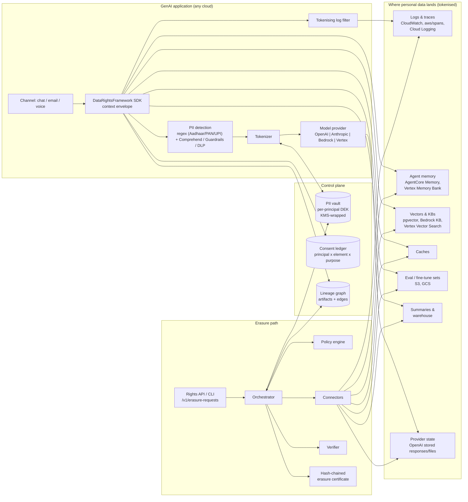
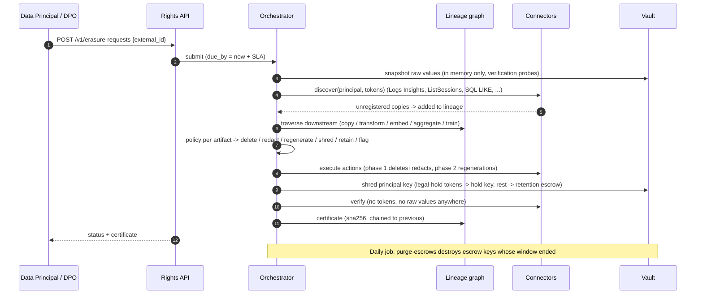

# Architecture

The framework has a **write path** (instrumentation that runs inside the GenAI app)
and an **erasure path** (the orchestrator that runs when a Data Principal
asks to be erased or withdraws consent).

## Component view

## Erasure sequence

## Why tokenise first

Erasure gets cheap when no store ever holds a raw identifier:

| Without tokenisation | With tokenisation |
|---|---|
| Find every copy of an email in logs, vectors, caches, backups | Destroy one key; every copy becomes unreadable |
| Immutable stores (CloudWatch, backups) cannot be fixed | Immutable stores are already safe after shredding |
| Third-party mentions undiscoverable | Mentions resolve to the right principal's token and get redacted precisely |
| Summaries must be regenerated blindly | Lineage says which summaries derived from whom |

## Key design choices

1. **Per-principal DEK, KMS-wrapped.** Tokens are `HMAC(DEK, type|value)`: stable for joins,
   caching and retrieval, unlinkable once the DEK is gone. Same email for two principals
   yields different tokens.
2. **Consent per element type and purpose.** `protect()` refuses to tokenise into a purpose
   the principal has not consented to (unless the purpose is *legitimate use*).
3. **Lineage is recorded at write time and repaired at erase time.** `track_artifact()`
   records edges; connector `discover()` finds copies written by code that bypassed the SDK.
4. **Edge types drive policy.** `copy` and `embed` delete; `transform` regenerates;
   `aggregate` is retained only above a k-anonymity threshold; `train` flags a model for retraining.
5. **Ownership vs mention.** An artifact produced in Rahul's context that mentions Priya is
   *redacted* when Priya is erased, not deleted.
6. **Statutory retention escrow.** DPDP Rules 2025 Rule 8(3) requires keeping personal data,
   traffic data and processing logs for at least a year from processing. On erasure the data
   leaves every operational store; the vault keeps a sealed escrow copy usable only through
   privileged reads, and `purge-escrows` destroys it when the window ends.
7. **Verification uses raw values held only in memory** during the run, so a leak that
   bypassed tokenisation (e.g. a legacy worker logging a phone number) fails the certificate.

## Native service mapping

| Concern | AWS | Google Cloud | OpenAI direct | Anthropic direct |
|---|---|---|---|---|
| Model calls | Bedrock Converse (+ Guardrails) | Vertex AI (google-genai) | Responses API, `store=false` | Messages API (stateless); Claude also on Bedrock/Vertex via `platform` |
| PII detection | Comprehend, Bedrock Guardrails | Sensitive Data Protection (DLP) | regex + either cloud | regex + either cloud |
| Vault keys | KMS (encryption context = principal) | Cloud KMS (AAD = principal) | local / either KMS | local / either KMS |
| Vault storage | DynamoDB | Firestore | SQL | SQL |
| Lineage DB | Aurora / RDS PostgreSQL | Cloud SQL / AlloyDB | any SQLAlchemy DB | any SQLAlchemy DB |
| Agent memory | AgentCore Memory (events + records) | Agent Engine Memory Bank | - | - |
| Observability | CloudWatch Logs, AgentCore spans (`aws/spans`), Bedrock invocation logs | Cloud Logging | - | - |
| Retrieval | Bedrock Knowledge Bases, pgvector | Vertex Vector Search | vector stores | bring your own (Claude has no embeddings API) |
| Datasets | S3 (all versions purged) | GCS | Files API | Files API (deleted by connector) |
| Scheduling | EventBridge Scheduler -> Lambda/ECS | Cloud Scheduler -> Cloud Run job | cron | cron |
