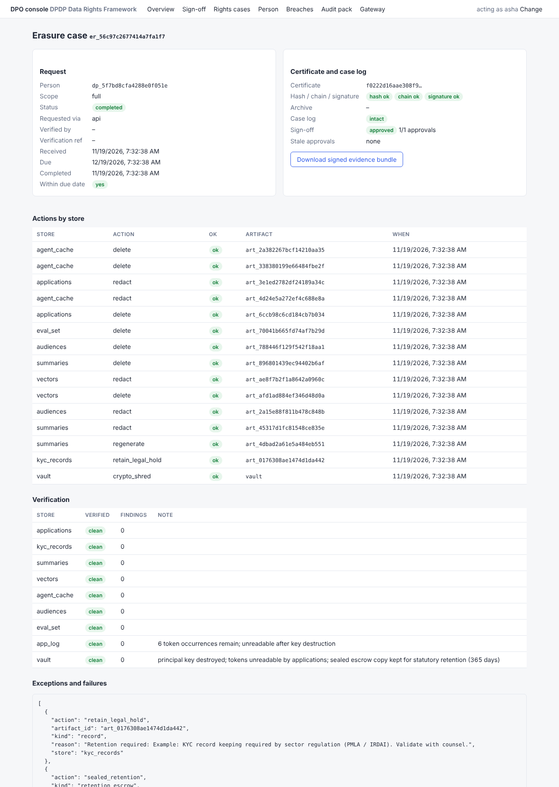
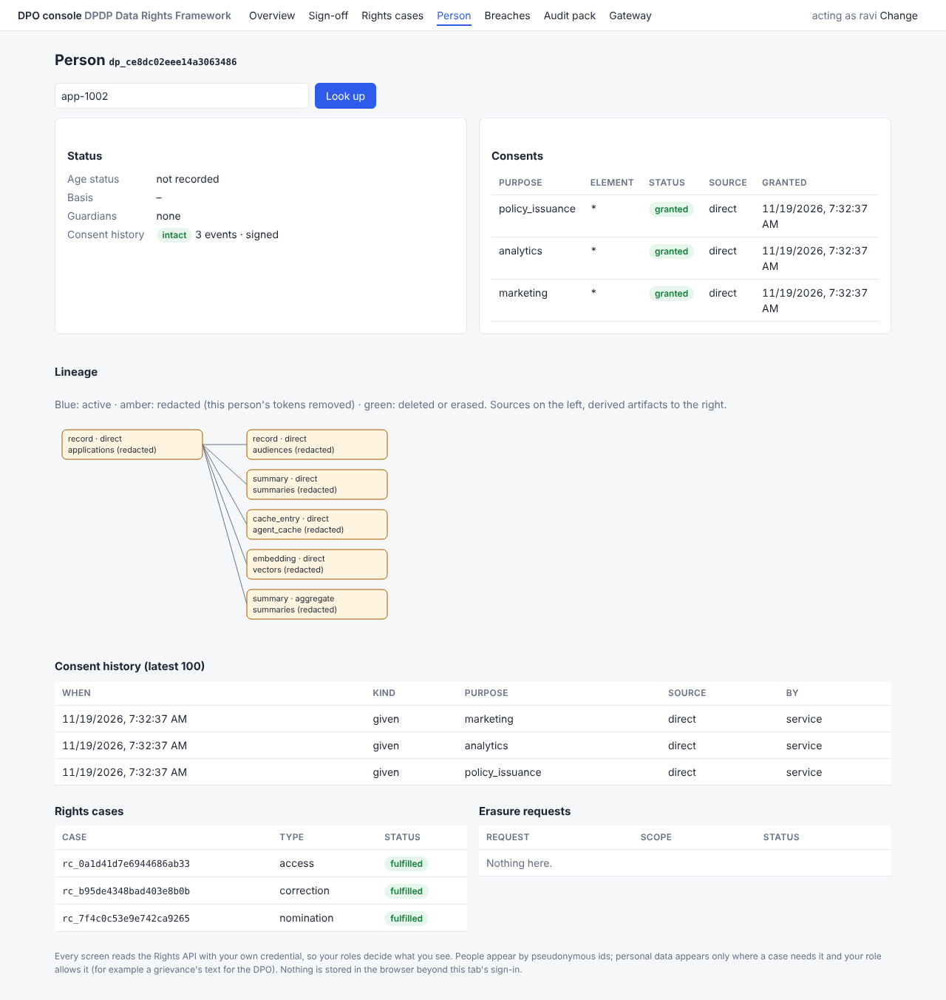

# DPO console

A web console for the Data Protection Officer, reviewers and auditors, at **`/console`** on the Rights API, for example http://localhost:8080/console after `dpdp-rights -c config/dpdp.local.yaml serve --port 8080`.

The console is three static files: no build step, no CDN, nothing loaded from elsewhere. It holds no data and no secrets. Every screen calls the Rights API with the signed-in person's own credential, so the API's roles decide what each person sees and can do; the console adds no access paths of its own.

## Screens

| Screen | What it shows | What you can do there | Roles |
|---|---|---|---|
| **Overview** | Erasures awaiting sign-off, open and overdue rights cases, overdue erasures, breach assessments, rights cases due soonest | Jump to any of them | dpo (reviewers see what their role allows) |
| **Sign-off** | Erasure and withdrawal requests with status, due date and sign-off state (pending, needs_info, approved, rejected, not yet reviewable) | Open a case | dpo, reviewer |
| **Erasure case** | The request, its due date and whether it was met; the certificate's hash, chain and signature checks; actions by store; verification per store; exceptions (legal holds, escrow) and failures; manual actions and reviews | **Record a review** against the checklist (approved, needs_info, rejected, with notes); **download the signed evidence bundle** | dpo, reviewer |
| **Rights cases** | Every case, filtered by type, status or overdue, with the rule-set version it was judged under | Open a case | dpo, reviewer |
| **Rights case** | Details, outcome, the signed event log and its integrity | **Decide** access, correction and nominee cases; **respond** to grievances; open a released access report | dpo, reviewer (decide); dpo (respond, access report) |
| **Person** | For one external id: age status and guardians, consents and their source, the **signed consent history** and whether it verifies, the **lineage graph**, rights cases and erasure requests | Open the cases | dpo |
| **Breaches** | Assessments, then for each one: verification, totals, exposure, kinds of data, Rule 7 deadlines, stores with processors and contracts, systems the framework cannot list | **Show the draft intimations**; **download the signed bundle** | dpo (drafts), dpo and reviewer (read) |
| **Audit pack** | — | **Download a signed audit pack** for a period | dpo, reviewer |
| **Gateway** | The [model gateway](gateway.md) report, when the gateway is enabled | — | dpo, reviewer |

Separation of duties is enforced by the API: the person who submitted a request can't decide it, and approvals recorded before a later manual action are shown as stale.

## Signing in

On the **Sign in** screen, choose one of:

- **API key:** a key issued for the Rights API, with roles `dpo`, `reviewer` or `approver`.
- **Bearer token:** an OIDC access token from your identity provider, carrying the same roles in the configured claim.
- **Development: act as:** with `auth.mode: none` (development only; refused in production), a name to act as. This makes it easy to show separation of duties: sign in as `asha` to submit and as `ravi` to review.

The credential is kept in the tab's session storage only. It is cleared when the tab closes or when you sign out.

## Security

- **Headers:** `/console` is served with `Content-Security-Policy: default-src 'self'; script-src 'self'; style-src 'self'; frame-ancestors 'none'; ...`, plus `X-Frame-Options: DENY`, `Referrer-Policy: no-referrer` and `Cache-Control: no-store`.
- **No inline code or HTML injection:** there is no inline script or style, and all data is inserted as text, never as HTML. A test fails if the code uses `innerHTML`, `eval`, external URLs or inline styles.
- **What it shows:** people appear by pseudonymous id. Personal data appears only where a case needs it and the role allows it, for example a grievance's text, which the DPO needs to answer it. Token values are never revealed here; break-glass reads stay in the API and CLI.
- **Switching it off:** `api.console: false` stops serving the files. The API itself is unaffected.
- **Network:** run it behind the same internal load balancer, WAF and TLS as the API ([security](security.md)).

## Limits

- **No single sign-on yet:** sign-in takes a pasted API key or OIDC token. An authorization-code flow with PKCE against the configured issuer is on the roadmap.
- **Not every task has a screen yet:** submitting requests, breach assessments, break-glass approvals and Consent Manager or children's records still go through the API or CLI.
- **One tenant per credential:** with tenants, each credential sees its own tenant.
- **Lineage graph size:** it draws everything for one person, which suits normal lineage sizes, not tens of thousands of artifacts.
