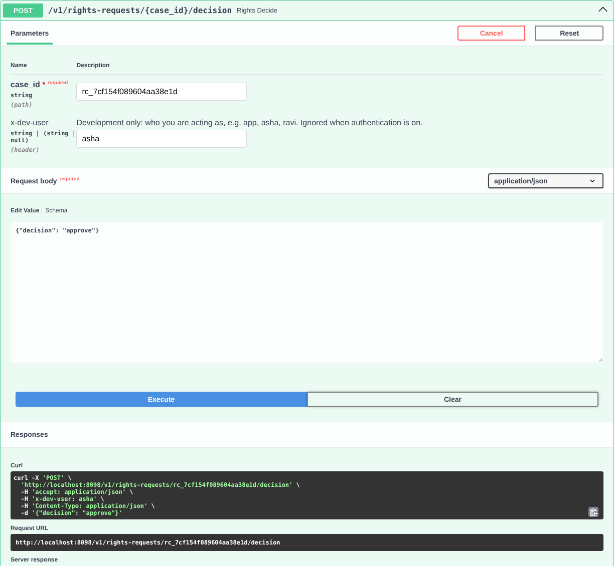

# Demo walkthrough: insurance onboarding

A guided tour of `examples/insurance_onboarding/demo.py`: what happens at each step, what to point at, and
which DPDP obligation it shows. Use it to understand the framework in ten minutes, or as a script when
presenting the demo to a customer, a DPO or a partner team.

Everything runs offline: an echo model instead of an LLM, a local key instead of KMS, SQLite instead of
cloud stores. All people and identifiers are fictional.

## Run it

```bash
pip install -e ".[dev]"
python examples/insurance_onboarding/demo.py --html          # terminal output + .dpdp/report.html
python examples/insurance_onboarding/demo.py --html --leak   # same, plus a raw-PII leak for verification to catch
```

Open `.dpdp/report.html` in a browser ([screenshots](images/), or the [two-minute captioned video tour](media/demo-tour.mp4)
for people who will not run it).

To record the tour again after changing the demo (needs Playwright and ffmpeg):
`python examples/insurance_onboarding/record_video.py` writes `.dpdp/demo-tour.mp4`. It is one self-contained page with the same story as the terminal
output, with highlighting, a lineage graph and before/after views. For a non-technical audience, present the
report rather than the terminal.

Run the demo from an empty folder: it writes its state to `.dpdp/` in the current directory and
starts fresh each time.

## The story

An AI agent onboards four applicants for insurance:

| Applicant | Product | Consents given |
|---|---|---|
| Priya Sharma | Term life | Policy issuance, analytics, marketing, agent improvement |
| Rahul Verma | Motor | Policy issuance, analytics, marketing. Names Priya as his nominee |
| Anita Rao | Health | Policy issuance, analytics, marketing |
| Vikram Iyer | Travel | Policy issuance, analytics |

Their data spreads into eight stores: application records, KYC records, a vector index, an agent cache,
underwriting notes and a weekly portfolio report, a marketing audience, an evaluation set, and the
application log.

- **Steps 1–6:** Anita withdraws one consent, and Priya withdraws everything and asks to be erased.
- **Step 7:** a manual step and a reviewer's sign-off produce a signed evidence bundle and an audit pack.
- **Step 8:** Rahul uses his other rights (access, correction, nomination), and Anita raises a grievance.

| Report section | Walkthrough step |
|---|---|
| 01 Personal data is tokenised before anything stores it | Step 1 |
| 02 Consent is recorded per person, per purpose | Steps 1–2 |
| 03 Anita withdraws marketing consent only | Step 2 |
| 04 Lineage: everything Priya's data turned into | Step 3 |
| 05 Priya withdraws all consent and asks to be erased | Step 4 |
| 06 After the erasure | Step 5 |
| 07 Verification and the erasure certificate | Step 6 |
| 08 Case record, reviewer sign-off and audit pack | Step 7 |
| 09 The other rights | Step 8 |

## Step 1: Personal data is tokenised before anything stores it

**What happens.** Each applicant's message passes through `dpdp.protect()` before it reaches the model,
the database, the vector index or the log. Personal data is detected and replaced with tokens:

```
told the agent:  My name is Priya Sharma ... Aadhaar 2345 6789 0124, PAN ABCPS1234K ... priya.sharma@example.in
stored as:       My name is <NAME_c2157a856105> ... Aadhaar <AADHAAR_c77398be9579>, PAN <PAN_61215641edd3> ... <EMAIL_3ea9cd6b8c82>
```

**What to point at.**
- Tokenisation covers what the detectors recognise. The demo uses regex plus a simple name cue; production
  should add a cloud detector, and anything the detectors miss is only caught by discovery and verification.
- Anita writes in Hinglish ("Mera naam Anita Rao hai") and Vikram in Hindi ("मेरा नाम विक्रम अय्यर है"):
  both names are detected and tokenised. Rahul's vehicle number is tokenised too.
- Detection is India-aware: the Aadhaar number is validated with its Verhoeff checksum, and PAN, UPI IDs
  and +91 phone numbers are recognised. Production adds Comprehend, Bedrock Guardrails or Cloud DLP.
- Rahul's message contains Priya's email (she is his nominee). It gets **the same token** as in Priya's own
  application, because her email was registered to her. That is how the framework later knows Rahul's
  record mentions Priya.
- Open `.dpdp/app.log`: the log lines contain tokens, not values, because the logging filter tokenised them.
- Each person has their own encryption key. Destroying that key later makes every copy unreadable,
  including copies in logs and backups that cannot be edited.

**DPDP:** reasonable security safeguards (Act s.8(5), Rule 6).

## Step 2: Anita withdraws marketing consent only

**What happens.** `dpdp.withdraw_consent(anita, "marketing")` records the withdrawal and runs a
purpose-scoped erasure. Her cross-sell audience entry is deleted. Her application stays, because her
consent for policy issuance is still valid.

**What to point at.** Consent is recorded per person **and per purpose**, so withdrawal can be precise.
Most systems record one consent flag per customer and can only do all or nothing.

**DPDP:** withdrawal as easy as giving consent (s.6(4)); stop processing and erase data held for that
purpose (s.6(6), s.8(7)).

## Step 3: Lineage, everything Priya's data turned into

**What happens.** `dpdp.lineage(priya)` walks the lineage graph and lists every artifact that contains her
data, directly or through derivation:

- **Direct:** her application, KYC record, embedding, cached agent reply, underwriting note, audience
  entry, eval-set row, plus Rahul's application, embedding, cache entry, note and audience entry (which
  mention her).
- **Derived:** the weekly portfolio report, which aggregates all four applications.

**What to point at.**
- This is the problem the framework exists to solve: consent was given once, but the data is in 14 places.
- Edges carry a type (`copy`, `embed`, `transform`, `aggregate`, `train`), and the type drives the erasure
  decision in step 4.
- One cache row was written by code that bypassed the framework, so it was never registered. It does not
  appear yet: discovery finds it in the next step. In the report it is the dashed box.

## Step 4: Priya withdraws all consent and asks to be erased (dry run)

**What happens.** All her consents are withdrawn, and `dpdp.erase(priya, dry_run=True)` prints the plan,
one decision per artifact with a reason:

| Artifact | Decision | Why |
|---|---|---|
| Her application, embedding, cache reply, audience entry | Delete | Held only for withdrawn purposes |
| The unregistered cache row | Delete | **Found by discovery**: the connector searched the table for her tokens |
| Eval-set row | Delete | Policy rule: never keep personal data in golden sets |
| Rahul's application, embedding, cache entry, note, audience entry | Redact | The records are Rahul's; only her details are removed. His embedding is recomputed from the redacted text, so no stale vector is left |
| Her underwriting note | Delete | A summary of her data only: nothing to rebuild it from |
| Weekly portfolio report | Regenerate | An aggregate of fewer than k people can identify her, so it is rebuilt without her |
| KYC record | Retain under legal hold | KYC record keeping is required by sector regulation (example basis; validate with counsel) |

Then the agent tries to process a new message from her and is **refused** with `ConsentDenied`, before
any model sees it.

**What to point at.**
- Ownership versus mention: deleting Rahul's application because it mentions Priya would destroy Rahul's
  data. Redaction is the right answer, and the framework reaches it automatically.
- Legal holds are explicit, with the legal basis written into the certificate.
- Dry run first: in production a DPO can review the plan before anything is changed.

**DPDP:** right to erasure (s.12(3)); legitimate uses and retention required by law (s.7, s.8(7)).

## Step 5: Execute the erasure

**What happens.** `dpdp.erase(priya)` carries out the plan.

```
Rahul's application BEFORE: ... Nominee is my wife, email priya.sharma@example.in ...
Rahul's application AFTER:  ... Nominee is my wife, email [ERASED] ...
Her email token now reads:  [ERASED]
```

**What to point at.**
- Rahul's application survives, with only Priya removed.
- Her key is destroyed, so her tokens now read `[ERASED]` everywhere, including in the application log,
  which was never edited.
- Her identifiers are kept in a sealed escrow for one year (DPDP Rules 2025, Rule 8(3)). Applications
  cannot read it. Only two-person, audited break-glass access can, and a scheduled job destroys it when
  the year ends. This covers the identifiers, not full records or traffic data; see the
  [Rule 8(3) mapping](dpdp-mapping.md#rule-83-one-year-retention).
- The weekly report shows `[echo model] Summary rebuilt from 3 remaining sources.` because the demo has
  no real model. With OpenAI, Claude, Bedrock or Vertex configured, the report is rewritten from the
  remaining three applications.

## Step 6: Verification and the erasure certificate

**What happens.** Every store is checked again, for her tokens and for her raw values (held in memory
only during the run). The certificate records every artifact, decision, exception and legal basis, plus
how the request was verified upstream, and is hash-chained to the previous certificate.

**What to point at.**
- Verification is independent of the plan: it re-scans the stores rather than trusting that the actions
  worked.
- Run with `--leak`: a "legacy dialer" writes Priya's raw phone number to the log, bypassing the framework.
  Verification reports `FAIL app_log ... raw_value_found` and the request ends `completed_with_exceptions`.
  The framework does not claim success when data is still there.
- In production the certificate is signed with a KMS key and archived in write-once storage, as evidence
  for the DPO or the Data Protection Board.

**DPDP:** accountability and evidence. Each request has a due date tracked by the SLA metrics; grievances
under Rule 14(3) are a separate clock handled in your own case system.

## Step 7: Case record, reviewer sign-off and audit pack

**What happens.** The contact-centre call recordings have no connector (see `inventory.yaml`), so an
operator deletes them by hand and records a manual action with the ticket number. A DPO then signs the case
off against the review checklist. Her first attempt is refused because the notes contain a phone number.
The demo writes a signed evidence bundle and an audit pack to `.dpdp/evidence/` and verifies the bundle
offline. Open `.dpdp/evidence/case.html` to read the case record, or section 08 of the HTML report.

**What to point at.**
- Automation is not the whole story; the case log shows what people did, with references.
- The reviewer could not have been the person who did the manual step (separation of duties).
- Every entry is hash-chained to the certificate and signed; `dpdp-rights evidence verify` checks the zip
  without any access to the system.
- The audit pack summarises a period: SLA, sign-off rate, certificate chain, findings. Anita's withdrawal is
  still `pending` sign-off, which is what a real queue looks like.

**DPDP:** accountability (s.8(1)) and audit evidence (s.10 for Significant Data Fiduciaries). See
[evidence.md](evidence.md).

## Step 8: The other rights: access, correction, nomination, grievance

**What happens.** Rahul asks what data the insurer holds. The rights desk prepares an access report from the
vault and the lineage graph, a DPO releases it, and it is written to `.dpdp/rights/access-report-rahul.html`
with values masked. He then corrects his UPI ID; once approved, his application shows the new handle without
any store being rewritten. He nominates his sister for death or incapacity. Anita raises a grievance about a
renewal SMS after she withdrew marketing consent; the DPO acknowledges it and resolves it within the 30-day
period. The Rule 14(1) notice is written to `.dpdp/rights/notice.md`.

**What to point at.**
- Every request type has the same intake, a due date from a versioned rule set, and a signed event history.
- The access report lists the processors that received his data, from configuration, and plain-language
  places ("Search index used by the assistant").
- The correction is one vault update that every tokenised copy sees.
- Personal data in the cases (the new UPI ID, the grievance text, the nominee) is stored as tokens.

**DPDP:** Act ss.11-14 and Rules r.14. See [rights.md](rights.md).

## Try it yourself through the API

After running the demo, start the Rights API on the demo's data, **from the same folder**:

```bash
C=<repo>/config/dpdp.local.yaml                 # full path to the local config
dpdp-rights -c $C serve --port 8080
```

Open **http://localhost:8080/docs** for the API's interactive page, or use the `curl` commands below in a
second terminal (same folder). The page works without internet access: its scripts are served by the
framework, not a CDN.

The local config has authentication turned off, which is for development only; production requires API keys
or OIDC tokens. Locally, every endpoint has an **`x-dev-user`** field (a header for `curl`) that names who is
calling, so you can see separation of duties: whoever submits a case cannot decide it. On the page: open an
endpoint, click *Try it out*, fill in `x-dev-user` (for example `app` to submit, `asha` to decide), edit the
body and click *Execute*.



Requests are queued; `dpdp-rights -c $C worker --once` processes the queue.

**1. Rahul withdraws marketing consent.**

```bash
curl -s -XPOST localhost:8080/v1/withdrawals -H 'content-type: application/json' \
  -d '{"external_id":"app-1002","purpose_id":"marketing","verified_by":"demo","verification_ref":"try-1"}'
dpdp-rights -c $C worker --once          # status completed; one action: his audience entry deleted
```

**2. Preview an erasure for Vikram** (a dry run returns the plan): his application, embedding and cache entry
are deleted, his underwriting note is deleted (a summary of his data only), and the weekly report is rebuilt
without him.

```bash
curl -s -XPOST localhost:8080/v1/erasure-requests -H 'content-type: application/json' \
  -d '{"external_id":"app-1004","dry_run":true}'
```

**3. Erase Vikram, check the certificate, sign the case off and export the evidence.**

```bash
curl -s -XPOST localhost:8080/v1/erasure-requests -H 'content-type: application/json' \
  -d '{"external_id":"app-1004","verified_by":"demo","verification_ref":"try-3"}'     # note the request_id
dpdp-rights -c $C worker --once
curl -s localhost:8080/v1/erasure-requests/<request_id>/certificate/verify          # hash, chain and signature ok
curl -s -XPOST localhost:8080/v1/erasure-requests/<request_id>/reviews -H 'x-dev-user: asha' \
  -H 'content-type: application/json' -d '{"decision":"approved","checklist":{"requester_verified":true,
  "scope_matches_request":true,"exceptions_justified":true,"verification_reviewed":true,"manual_systems_done":"n/a"}}'
curl -s localhost:8080/v1/erasure-requests/<request_id>/evidence -o evidence.zip
dpdp-rights evidence verify evidence.zip                                             # "ok": true, offline
```

**4. Anita asks what data you hold.** A service submits, a DPO releases, and the report is delivered.

```bash
curl -s -XPOST localhost:8080/v1/rights-requests -H 'x-dev-user: app' -H 'content-type: application/json' \
  -d '{"type":"access","external_id":"app-1003","verification_ref":"try-4"}'          # note the case_id
curl -s -XPOST localhost:8080/v1/rights-requests/<case_id>/decision -H 'x-dev-user: asha' \
  -H 'content-type: application/json' -d '{"decision":"approve"}'
curl -s "localhost:8080/v1/rights-requests/<case_id>/access-report?format=html" -o access.html   # open in a browser
```

Try the decision with `x-dev-user: app` first: it is refused, because the submitter cannot decide.

**5. Anita raises a grievance, and the DPO resolves it.**

```bash
curl -s -XPOST localhost:8080/v1/rights-requests -H 'x-dev-user: app' -H 'content-type: application/json' \
  -d '{"type":"grievance","external_id":"app-1003","details":{"category":"consent","description":"I still get renewal SMS"}}'
curl -s -XPOST localhost:8080/v1/rights-requests/<case_id>/response -H 'x-dev-user: asha' \
  -H 'content-type: application/json' -d '{"status":"fulfilled","response":"Removed from the SMS list, ticket MKT-9"}'
```

**6. The published notice, the queues and an audit pack.**

```bash
curl -s "localhost:8080/v1/rights/notice?format=html"     # the Rule 14(1) notice for the website (public)
curl -s localhost:8080/v1/sla                             # open requests and rights cases by due-date bucket
dpdp-rights -c $C audit-pack --from <yesterday> --to <tomorrow> --output audit.zip   # dates as YYYY-MM-DD
```

**7. Inspect lineage.** `dpdp-rights -c $C lineage --external-id app-1002`.

You can also open the demo's stores directly:

- `.dpdp/app.db` (SQLite: applications, kyc_records, chunks, cache, summaries, audiences)
- `.dpdp/app.log` and `.dpdp/evals/agent_golden.jsonl`
- the outputs in `.dpdp/evidence/` (case record, evidence bundle, audit pack) and `.dpdp/rights/` (access report, notice)

## Adapting the demo to another domain

Only the purposes and stores are insurance-specific. They live in
[`config/dpdp.local.yaml`](../config/dpdp.local.yaml). Rename the purposes (for example
`loan_origination`, `collections` for lending, or `care_delivery` for healthcare), point the connectors at
your tables, and the same flow applies. The [integration guide](integration-guide.md) covers doing this
in a real agent.
