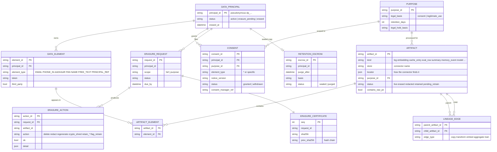
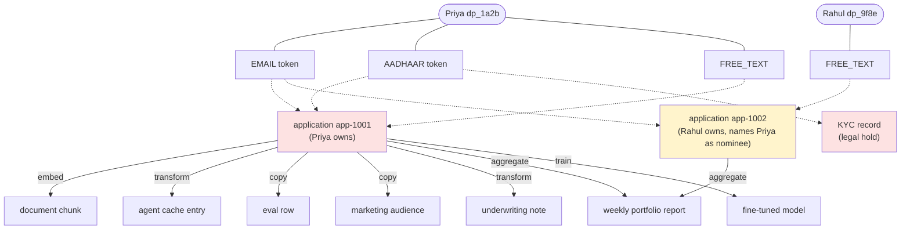

# Lineage data model

Consent is usually recorded against a *customer*. Personal data, however, moves as
*elements* (an email, a phone number, an Aadhaar number, free text) into many
*artifacts*. This model tracks all three so an erasure request can be resolved
to every place the data went.

## Entity-relationship diagram



## Worked example (insurance onboarding agent)



When Priya withdraws consent and asks to be erased, the framework deletes her application, document
chunk, cache entry, eval row and marketing audience entry. It **redacts** her email token in Rahul's
application, because Rahul owns that record and Priya is only mentioned as his nominee. It regenerates
her underwriting note, and regenerates or retains the portfolio report depending on the k-threshold.
It flags the fine-tuned model for retraining and keeps the KYC record sealed under a legal hold. Her
key is shredded, with an escrow copy kept for the statutory retention window.

If she had withdrawn only `marketing`, only the artifacts processed for that purpose (the audience
entry) would be erased and her application would continue.

## Traversal as SQL (PostgreSQL)

The Python store does a portable BFS; this recursive CTE is equivalent and
useful for audits directly on Aurora / Cloud SQL / AlloyDB:

```sql
WITH RECURSIVE direct AS (
  SELECT DISTINCT ae.artifact_id
  FROM artifact_element ae
  JOIN data_element de ON de.element_id = ae.element_id
  WHERE de.principal_id = :principal_id
),
reach(artifact_id, depth, edge_type, path) AS (
  SELECT artifact_id, 0, 'direct'::text, ARRAY[artifact_id]::text[] FROM direct
  UNION ALL
  SELECT le.child_artifact_id, r.depth + 1, le.edge_type, r.path || le.child_artifact_id
  FROM reach r
  JOIN lineage_edge le ON le.parent_artifact_id = r.artifact_id
  WHERE NOT le.child_artifact_id = ANY(r.path)          -- cycle guard
)
SELECT a.artifact_id, a.kind, a.store, a.locator, a.status,
       MIN(r.depth) AS depth, array_agg(DISTINCT r.edge_type) AS via_edges
FROM reach r JOIN artifact a USING (artifact_id)
GROUP BY a.artifact_id, a.kind, a.store, a.locator, a.status
ORDER BY depth;
```

## DDL (PostgreSQL)

The framework creates these automatically through SQLAlchemy; shown here for review.

```sql
CREATE TABLE data_principal (principal_id varchar(64) PRIMARY KEY, status varchar(24) NOT NULL,
  created_at timestamptz NOT NULL, erased_at timestamptz);
CREATE TABLE data_element (element_id varchar(64) PRIMARY KEY,
  principal_id varchar(64) NOT NULL REFERENCES data_principal, element_type varchar(40) NOT NULL,
  token varchar(64), third_party boolean, created_at timestamptz NOT NULL);
CREATE INDEX ON data_element (principal_id); CREATE INDEX ON data_element (token);
CREATE TABLE purpose (purpose_id varchar(64) PRIMARY KEY, description text, legal_basis varchar(24),
  retention_days int, legal_hold_basis text);
CREATE TABLE consent (consent_id varchar(64) PRIMARY KEY, principal_id varchar(64) NOT NULL REFERENCES data_principal,
  purpose_id varchar(64) NOT NULL REFERENCES purpose, element_type varchar(40) NOT NULL DEFAULT '*',
  notice_version varchar(24), status varchar(16) NOT NULL, consent_manager_ref varchar(128),
  granted_at timestamptz NOT NULL, withdrawn_at timestamptz);
CREATE TABLE artifact (artifact_id varchar(64) PRIMARY KEY, kind varchar(32) NOT NULL, store varchar(64) NOT NULL,
  locator jsonb NOT NULL, purpose_id varchar(64), status varchar(24) NOT NULL, contains_raw_pii boolean,
  created_at timestamptz NOT NULL, retain_until timestamptz);
CREATE TABLE artifact_element (artifact_id varchar(64) REFERENCES artifact, element_id varchar(64) REFERENCES data_element,
  PRIMARY KEY (artifact_id, element_id));
CREATE TABLE lineage_edge (parent_artifact_id varchar(64) REFERENCES artifact, child_artifact_id varchar(64) REFERENCES artifact,
  edge_type varchar(16) NOT NULL, created_at timestamptz NOT NULL, PRIMARY KEY (parent_artifact_id, child_artifact_id));
CREATE INDEX ON lineage_edge (child_artifact_id);
-- erasure_request, erasure_action, erasure_certificate, retention_escrow: see src/dpdp_rights/lineage/store.py
```

## Vault tables (separate trust boundary)

| Table | Key | Contents |
|---|---|---|
| `vault_key` | principal_id | DEK wrapped by KMS (encryption context / AAD = principal id) |
| `vault_value` | token | AES-GCM ciphertext of the value (AAD = token), owner principal, type |
| `vault_lookup` | HMAC(lookup key, type\|value) | principal id (resolves identifiers without storing them) |

Keep the vault in a different account/project from the lineage DB, with its own IAM.
