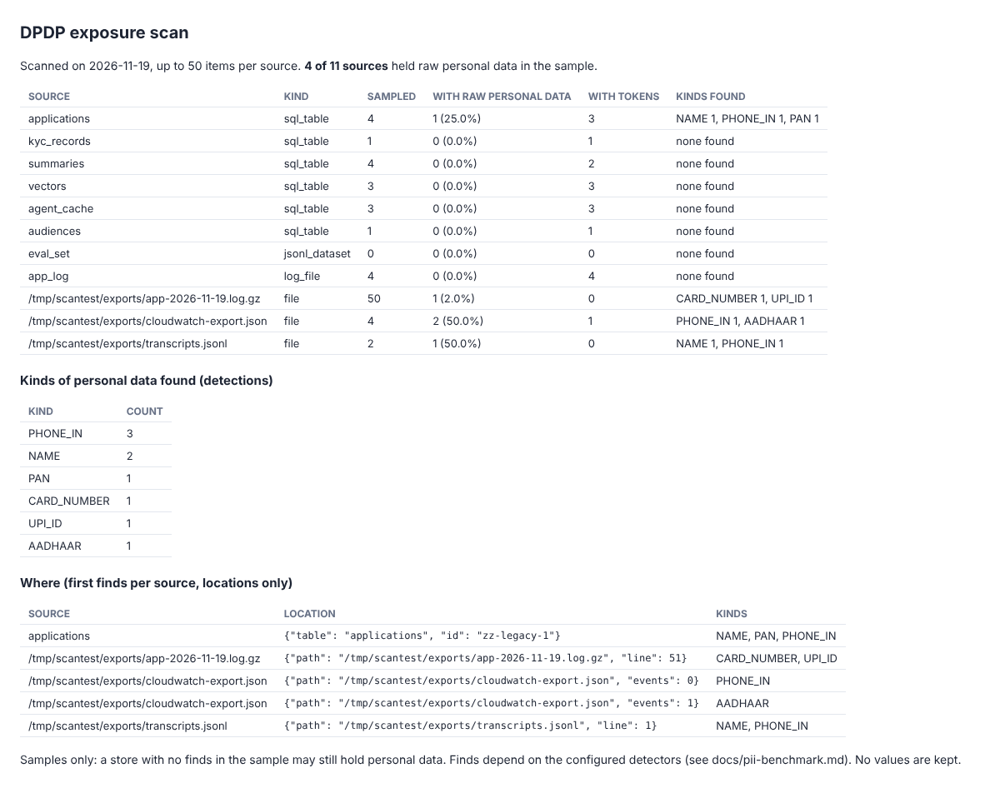

# Discovery scan: where raw personal data sits today

`dpdp-rights scan` is a **read-only** sweep for the first days of an engagement, before any code changes. It samples existing stores and exported files, runs the PII detectors over what it reads, and reports:
- which sources hold raw personal data, of which kinds;
- how much is already tokenised;
- the location of the first finds.

It can also draft the inventory entries for the [coverage report](../partner-pack/README.md).

```bash
# Exported files only: no credentials, no config needed
dpdp-rights scan --path exports/ --inventory-out draft-inventory.yaml

# The stores in a client config, through their connectors, read-only
dpdp-rights -c client.yaml scan --limit 200 --format md > exposure.md
dpdp-rights -c client.yaml scan --store app_logs --store transcripts_bucket --detectors regex,remote_ner
```



## Sources

**Exported files (`--path`)** take files or folders, including gzipped files:

| Format | How it's read |
|---|---|
| `.log`, `.txt` | One record per line |
| `.jsonl`, `.ndjson` | One record per line |
| `.json` | A JSON array, or an object holding `events`, `entries`, `data`, `logEvents`, `records` or `items` (this covers CloudWatch and Cloud Logging API exports and most trace exports) |
| `.csv` | One record per row |

Other files (PDFs, audio, images) are skipped. Large files are sampled evenly across the whole file, not just from the top.

**Configured stores** are read through each connector's `sample()` method, newest items first:

| Connector | How it reads, read-only | Permission it needs |
|---|---|---|
| `sql_table` | `SELECT` newest rows: the content column, or every text column | `SELECT` |
| `jsonl_dataset`, `log_file` | Reads the file | File read |
| `redis_cache` | `SCAN` (never `KEYS`) and `GET` on string values | Read commands |
| `aws_cloudwatch_logs` | `FilterLogEvents` in the lookback window, split across log groups | `logs:FilterLogEvents` |
| `aws_s3_objects` | Lists objects under `scan_prefix` (default: the part of `prefix_template` before `{principal_id}`) and reads the first 64 KB of text objects | `s3:ListBucket`, `s3:GetObject` |
| `aws_dynamodb` | `Scan` with a `Limit`; this uses read capacity | `dynamodb:Scan` |
| `gcp_cloud_logging` | `entries.list`, newest first | `roles/logging.viewer` |
| `gcp_bigquery` | `tabledata.list` (`list_rows`), which **runs no query and costs nothing** | `bigquery.tables.getData` |
| `langfuse` | `GET /api/public/traces`, newest first (name, input, output, metadata) | A read API key |

Connectors that can't read content (AgentCore, X-Ray, Cloud Trace, vector search services, the model providers) are listed as **not sampled**, never as clean. Check those by hand, or through lineage once instrumented.

Run the scan with a **read-only role**: the permissions above and nothing else. The connectors' write paths are never called, and a test checks that files, databases, S3 versions and DynamoDB items are unchanged after a scan. The scan builds the detectors and connectors from the config but not the framework, so it doesn't create the control-plane database either.

## What it reports

Every report opens with a **scope and limits** box:
- how many items were sampled, and the per-source limit;
- which sources were scanned, which could not be read, and which failed;
- the detectors used;
- the statement that a sample can miss personal data and is not a complete inventory.

The JSON has the same facts under `scope`, with `complete_inventory: false`.

**Per source:**
- items sampled;
- items holding raw personal data, and the share;
- items holding vault tokens, which shows how far instrumentation has got;
- kinds found (detections per type);
- the locations of the first five finds: a file and line, a table and id, an S3 key, a log stream and event id.

**Overall:** the kinds found, the sources not sampled, and the sources that failed (for example, access denied). One source failing doesn't stop the scan.

**No values are kept.** Text is read into memory, run through the detectors and discarded. The report and the draft hold counts and locations only, and tokens are counted but never mistaken for raw data.

**Limits:**
- **Samples, not a census.** A source with no finds in its sample may still hold personal data. Raise `--limit` (up to 10,000 per source) for confidence on large stores.
- **Finds depend on the detectors.** Regex alone misses most names that have no cue phrase ([benchmark](pii-benchmark.md)). Add `remote_ner` or a cloud detector with `--detectors`. The `llm` detector is refused here, because it would send raw text to a model.
- **Unconfigured stores aren't found.** It scans only what it is pointed at; the [questionnaire](../partner-pack/discovery-questionnaire.md) is how you find the rest.

## The draft inventory

`--inventory-out draft.yaml` writes one entry per source in the [inventory format](../partner-pack/inventory.template.yaml), and refuses to overwrite an existing file. Each entry gets:
- the category and platform from the connector type;
- `holds_personal_data`, plus the detected kinds as `data_elements`;
- the connector name;
- a description starting `DRAFT` with the sample figures.

Purposes, region, owner, processor, contract, retention and test dates are left empty for the workshop.

**Every entry says `holds_personal_data: true`, even when the sample found nothing.** No finds in a sample doesn't show a system holds none, and the coverage report treats `false` as out of scope. The note on each entry gives the sample figures; set it to `false` only after checking. The file's header says it lists only the scanned sources and is not a complete inventory. Then:

```bash
dpdp-rights -c client.yaml coverage --inventory draft.yaml --format html --output coverage.html
```

## In an engagement

In the [two-week assessment](../partner-pack/rapid-assessment.md), run it on days 2-4, alongside the gateway in observe mode:
- the gateway shows what reaches the models now;
- the scan shows what has already been written to logs, traces, tables and buckets.

Together they give the readout's "where data leaks today" section, from the client's own systems.
