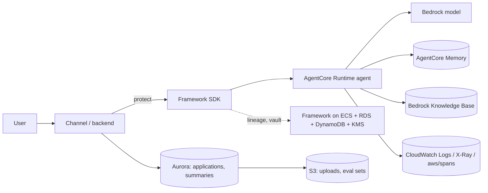
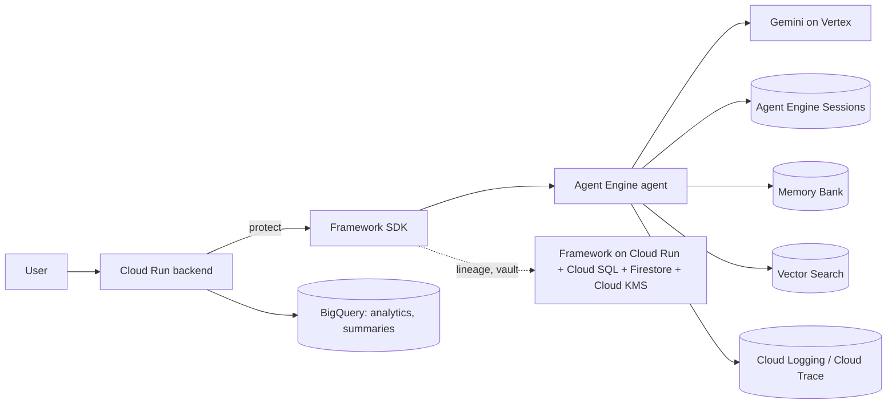
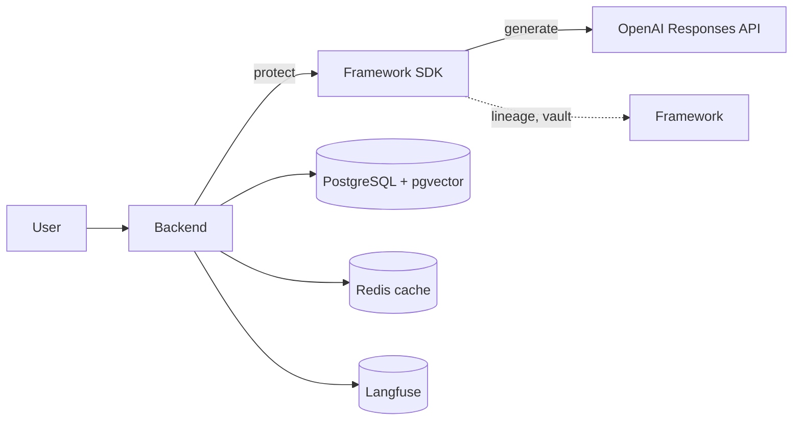
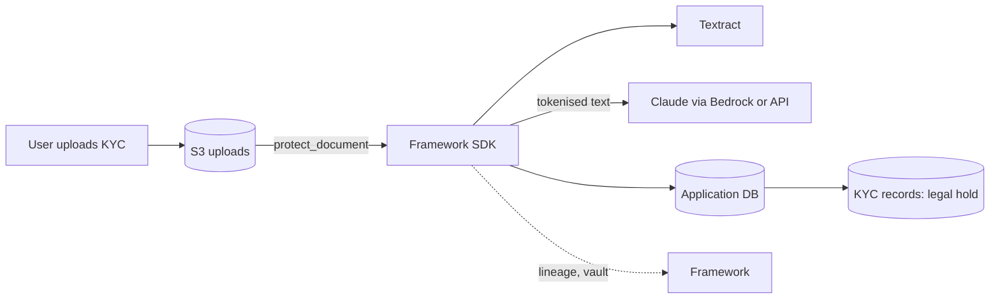

# Reference architectures

Four common patterns. For each: where personal data lands, which connectors and detectors to use, and
what to watch for. Start from the closest pattern, then adjust the [inventory](inventory.template.yaml).
Capabilities and limits of each connector: [capability matrix](../docs/capabilities.md).

## A. Bedrock agent on AgentCore, with RAG (AWS)

| Where data lands | Connector | Notes |
|---|---|---|
| Model calls | none needed | Bedrock keeps no prompt state; turn model invocation logging off or point it at a log group covered below |
| AgentCore Memory | `aws_agentcore_memory` | Use the pseudonymous principal as `actorId` (the `AgentCoreMemory` helper does this) |
| Knowledge base | `aws_bedrock_kb` | Registered documents only; re-ingest after redaction |
| Logs, spans, traces | `aws_cloudwatch_logs`, `aws_xray` | Crypto-shred + retention; keep log groups ≥ 365 days for Rule 8(3) |
| Application DB, pgvector | `sql_table` (set `embedding_column` on vector tables) | |
| Uploads, eval sets | `aws_s3_objects`, `jsonl_dataset` | S3 connector purges all versions |
| Per-user OAuth tokens | `aws_agentcore_identity` | Revocation at the IdP, not deletion |

Detectors: `[regex, aws_comprehend]`; add `transformers_ner` for Indian-language names; Textract for KYC
documents. Deploy with [deploy-aws.md](../docs/deploy-aws.md).

## B. Vertex AI Agent Engine (Google Cloud)

| Where data lands | Connector | Notes |
|---|---|---|
| Sessions, Memory Bank | `gcp_agent_engine_sessions`, `gcp_vertex_memory_bank` | v1beta1 APIs: pin and retest on upgrades |
| Vector Search | `gcp_vertex_vector_search` | Registered datapoints only; no read-back verification |
| Logging, Trace | `gcp_cloud_logging`, `gcp_cloud_trace` | Crypto-shred + retention |
| BigQuery | `gcp_bigquery` | Streaming buffer can delay deletes |

Detectors: `[regex, gcp_dlp]` plus `transformers_ner`; Document AI for documents. Deploy with
[deploy-gcp.md](../docs/deploy-gcp.md).

## C. OpenAI API with pgvector and Langfuse (any cloud)

| Where data lands | Connector | Notes |
|---|---|---|
| OpenAI stored state | `openai_platform` | `store: false` by default; if stored, `generate()` registers it; abuse-monitoring retention is outside API control |
| PostgreSQL, pgvector | `sql_table` with `embedding_column` | |
| Redis | `redis_cache` | Only keys indexed with `track_cache_key` are found |
| Langfuse | `langfuse` | Traces by `userId`: set it to the pseudonymous principal |

Detectors: `[regex, presidio]` keeps detection in-process. If raw text must not leave India, check where
the model provider processes requests, and consider a zero-data-retention agreement.

## D. Document-heavy onboarding: KYC uploads with Claude (Bedrock or API)

| Where data lands | Connector | Notes |
|---|---|---|
| Original uploads | `aws_s3_objects` | The file itself is not redacted; register it with `track_artifact` so erasure deletes it |
| Extracted, tokenised text | `sql_table` | |
| KYC records | `sql_table` under a `kyc_regulatory` purpose with `legal_hold_basis` | Kept sealed on erasure; counsel validates the basis |
| Anthropic Files API (if used) | `anthropic_platform` | |

Detectors: `[regex, aws_comprehend]` plus Textract (`pii.documents.ocr: textract`); `surrogates:
[AADHAAR, PAN]` if downstream KYC systems validate formats.

## Cross-cutting

- **Pseudonymous IDs everywhere.** Use `dpdp.principal(...)` as the user key in memory, traces,
  observability and caches. Never the email or phone number.
- **Every write is tracked.** One `track_artifact` per persisted item, with parents and edge type.
  Discovery is the safety net, not the plan.
- **Logs: one year.** Rule 8(3) and erasure pull in opposite directions; tokens let you keep logs for a
  year while making them unreadable for erased people.
- **Third parties.** Register identifiers of people who are mentioned (nominees, family) so their
  mentions resolve to them.
