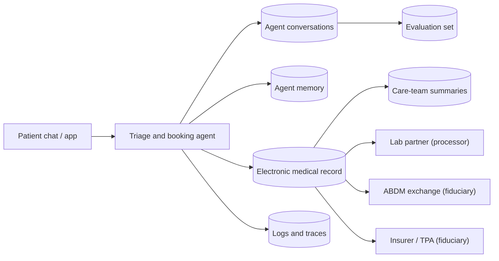

# Healthcare pack

For AI agents that book appointments, triage symptoms, support care teams and file insurance claims
(hospitals, clinics, telemedicine, diagnostics, health apps). **Not legal advice.** Every hold and period here
is a starting point for counsel; record their review in `reviewed` in `pack.yaml`.

## Where personal data goes

## Purposes and holds

| Purpose | Basis | On erasure |
|---|---|---|
| appointment_and_triage, care_delivery | Consent | Deleted; a summary of one patient is deleted |
| clinical_records | Legitimate use (law) | Retained under a sealed hold: IMC Regulations 2002 reg. 1.3.1 (indoor patients, three years from the start of treatment), or longer under state rules or medico-legal holds |
| abdm_linking | Consent (through ABDM) | Deleted; care continues |
| insurance_claims | Consent | Deleted at the provider; the insurer keeps its own records |
| research_and_quality, model_improvement, marketing | Consent | Deleted; withdrawal stops processing at once |

The pack sets access requests to a three-day due date, to line up with the 72-hour medical-records rule
(IMC reg. 1.3.2). The DPDP access summary is a separate obligation. Aggregates use k = 20.

## Health data needs more than regex

Symptoms, diagnoses, medicines and names written without a cue are free text. Scenario `hc-05` shows what
happens with regex alone: a name in a log survives shredding, verification catches it, and the case ends
`completed_with_exceptions`. Use an NER, cloud or LLM detector in production, and measure it on a sample of
the client's conversations (acceptance criterion A10).

## What partners confirm with the client

- Record periods for indoor, outpatient, diagnostic and medico-legal records under state law and the hospital's policy.
- Whether minors are patients. Verifiable parental consent (s.9) is not implemented yet.
- ABDM roles (HIP, HIU) and how consent artefacts are stored.
- UHID / MRN formats (edit `pii.patterns`).

## Scenarios

`dpdp-rights packs test healthcare`:
- ABDM linking withdrawal
- patient erasure with clinical records held
- caregiver redaction
- access timing and recipients
- the regex safety-net case

Discovery questions: [questions.md](questions.md).
