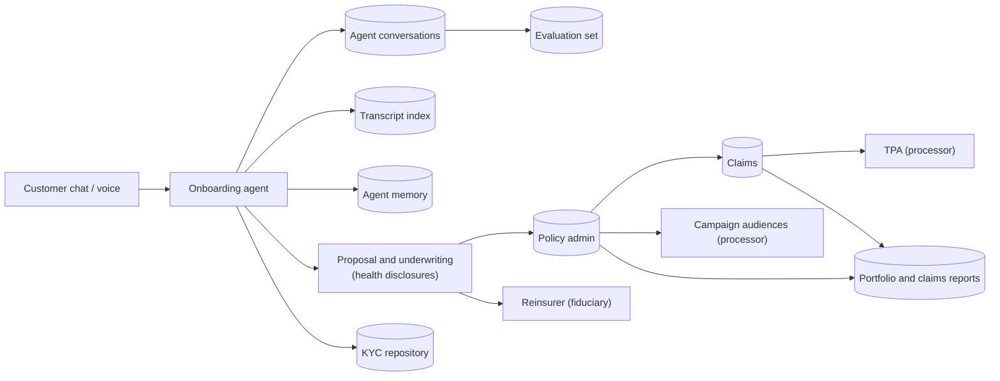

# Insurance pack

For AI agents that quote, onboard, service policies and handle claims (life, health, motor, general).
**Not legal advice.** Every legal hold and period here is a starting point for counsel; record their review in
`reviewed` in `pack.yaml`.

## Where personal data goes

## Purposes and holds

| Purpose | Basis | On erasure |
|---|---|---|
| quote_and_onboarding, underwriting, servicing | Consent | Deleted (summaries of the person deleted; reports over several people rebuilt or retained above k) |
| policy_records | Legitimate use (law) | Retained under a sealed hold: IRDAI 2025 information regulations, insurer's records policy |
| claims | Consent, with a hold | Retained under a sealed hold, as above |
| kyc_aml | Legitimate use (law) | Retained under a sealed hold: PMLA s.12, five years after the relationship ends |
| marketing, analytics, model_improvement | Consent | Deleted; withdrawal stops processing at once |

## What partners confirm with the client

- The retention period per product line under the board-approved records policy, and when it starts.
- Whether claims are a separate purpose or part of servicing; open claims and litigation holds.
- Which recipients are processors (TPA, contact centre, campaign platform) and which are fiduciaries
  (reinsurers, bureaus, registries); which, if any, are withheld under s.11(2).
- The format of policy and claim numbers (edit `pii.patterns`).

## Scenarios

`dpdp-rights packs test insurance`: marketing withdrawal, policyholder erasure with legal holds, nominee
redaction, and an access report that names the TPA. Discovery questions: [questions.md](questions.md).
