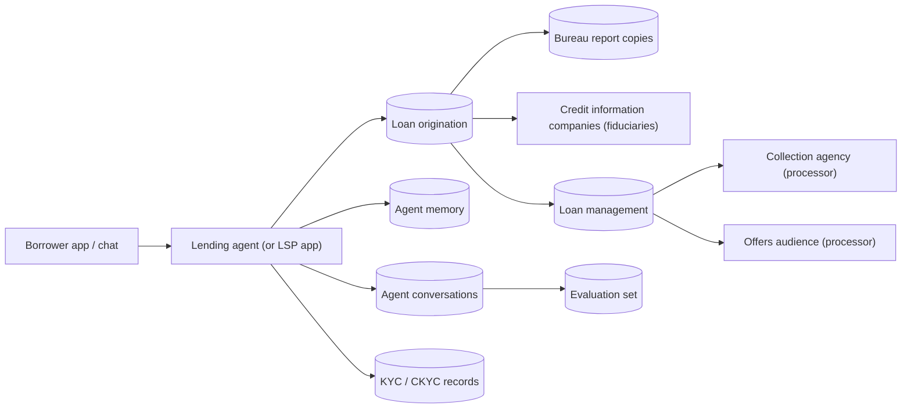

# Lending pack

For AI agents that take loan applications, assess credit, service loans and handle collections (banks,
NBFCs, digital lenders and their lending service providers). **Not legal advice.** Every hold and period here is
a starting point for counsel; record their review in `reviewed` in `pack.yaml`.

## Where personal data goes

## Purposes and holds

| Purpose | Basis | On erasure |
|---|---|---|
| loan_application, credit_assessment | Consent | Deleted, including the lender's copy of bureau reports (the bureau keeps its own) |
| loan_account | Legitimate use (law) | Retained under a sealed hold: PMLA s.12 and RBI KYC Master Direction, five years after closure |
| kyc_aml | Legitimate use (law) | Retained under a sealed hold: PMLA s.12 |
| collections | Consent | Deleted once no longer needed; the loan record itself stays under hold |
| marketing, analytics, model_improvement | Consent | Deleted; withdrawal stops processing at once |

RBI's Digital Lending Directions 2025 add:
- need-based collection with explicit consent
- revocation and deletion on request
- storage in India
- no access to contacts, call logs or media
- no stored biometrics

The coverage report flags systems outside Indian regions. Code review and verification should check that
apps never collect device data.

## What partners confirm with the client

- When the account is "closed" for PMLA purposes (full repayment, write-off, settlement) and how long loan files are kept.
- Which LSPs, DLAs, co-lenders, collection agencies and bureaus receive data; which are processors and which fiduciaries.
- Loan account number format (edit `pii.patterns`).
- How bureau disputes are routed when a borrower asks to correct data already reported.

## Scenarios

`dpdp-rights packs test lending`:
- erasure of a declined applicant (only KYC kept)
- an active borrower's marketing withdrawal, access report and erasure (loan records kept)
- a mobile-number correction that every copy reflects

Discovery questions: [questions.md](questions.md).
